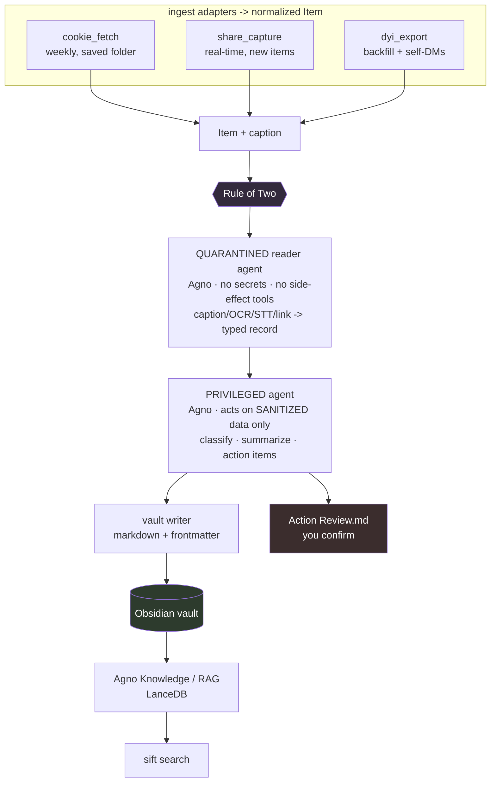

# Sift — Design Doc / Product Documentation

*Working name: **Sift** — "turn your Instagram saves into a searchable second brain." Rename freely.*
*Created 2026-07-22 · Updated 2026-07-22 (v2: hybrid ingestion, captions, Agno agents, guardrail harness) · Owner: Spongebob*
*Single source of truth. Living document — edit as decisions change. Agent/guardrail detail lives in `AGENTS.md`.*

---

## 0. TL;DR

You save a lot to Instagram — reels, carousels, links, videos of people talking, content in several languages — by sending it to yourself in DMs or hitting *Save*. It piles up in a folder you never revisit, you can't search *inside* it, and you don't know if something in there needs action (an application, a deadline). For many saves the reel is fluff and the **caption** is the real content.

**Sift** is a **local, personal** system that:

1. **Ingests** everything you saved / DM'd-to-yourself via a **local-first hybrid** (weekly cookie-based fetch of your Saved folder + a share-sheet capture path + an occasional official export) — see §4. No cloud scraping of your account.
2. **Extracts** the content by type — **the caption first** (structured text, richest signal), then OCR for image carousels, speech-to-text for reels/videos (via `freeflow`), readable-content for links.
3. **Files** each item as an **Obsidian-compatible markdown note** in your vault.
4. **Indexes** it for **RAG search** ("what was that recipe with brown butter?").
5. **Surfaces** a **review digest** of candidate time-sensitive items (deadlines, applications) that **you confirm** — no unattended autopilot.

It is built as **Agno agents** behind one callable core, with a **guardrail harness** on every agent (PII, no shell, Rule-of-Two for untrusted content). It is deliberately shaped to **fold into the Life Planner "second brain that acts"** later as a background agent + dashboard.

---

## 1. Why this exists (personal-first)

- **The pain is real and verified.** "My saved folder is a graveyard" is a widely-documented complaint. Instagram's native *Saved* gives you no text search inside posts, no transcription, no OCR, no "did I miss anything" surface.
- **No existing tool does your specific combo.** Every competitor covers a slice and writes to *their* cloud. None do deep multimodal extraction (caption + carousel OCR + multilingual reel STT + link content) **into your own local markdown vault** with RAG **and** an action-review layer. (Fabric — the closest — was rejected 2026-07-22: cloud/closed, fails local-first, no action alerts.)
- **You're equipped.** You built `freeflow` (STT); in 2026 the ML blocks are commoditized. The hard part is ingestion transport, extraction precision, and agent safety — not models (§13).

**This is a personal tool, not a product.** As a paid product it's Bad (saturated; read-later graveyard; Instagram absorbing the job; commoditized wedges). Build it for yourself; open-source it if you want.

---

## 2. North Star & Principles (hard rules)

**North star:** everything meaningful you ever saved on Instagram becomes *findable, readable, and actionable* from your own vault — with near-zero ongoing effort.

1. **Local-first.** Data lives in your Obsidian vault as plain markdown; agent state in a local DB. You own it. Models are provider-swappable and can run local.
2. **Minimize account risk; never the mobile private API.** Ingestion is the **local-first hybrid** in §4. **`instagrapi` (mobile private API) is banned as a dependency** — it's the highest-ban-risk path and it's your main account. The recurring path is a *read-only, low-cadence, cookie-authenticated* local fetch; new items come in via a zero-risk share-sheet; DMs/backfill come from the official export.
3. **Captions are first-class.** Every item's caption is extracted and analyzed, not treated as metadata. It's often the richest content.
4. **Agno for all agents.** Every agent in Sift (and across the broader project) is built on **Agno v2** — persistent storage, RAG, reasoning, tools, MCP. Not LangChain. See `AGENTS.md`.
5. **Guardrail harness on every agent.** PII block (Presidio + LLM Guard + egress allowlist); **no generic shell/code tool** — only narrow typed tools; human-approval on writes; **Rule of Two** for untrusted caption/link content; sandbox any unavoidable code-exec. See `AGENTS.md`.
6. **Draft-then-approve.** Action items are *proposed* into a review digest; nothing schedules/alerts autonomously in v1.
7. **Fold-ready.** Same vault + Life-Planner-compatible frontmatter; one callable `core.run()`; ingestion behind swappable adapters so a future scheduled agent just changes the source.
8. **Thin v1, honest scope.** Ship reliable modalities first; defer the time-sinks (§3).

**Non-goals for v1:** unattended/autopilot alerting; non-English *target* translation; burned-in-caption video-frame OCR; a GUI (arrives via Life Planner); the Meta Data Portability developer API (§4); `instagrapi`; multi-user/product/billing.

---

## 3. Scope

| Stage | v1 does | Deferred (v-next) |
|------|---------|-------------------|
| Ingest — saved posts | **Weekly local cookie-fetch** (gallery-dl) of your Saved folder, incremental | — |
| Ingest — new items | **Share-sheet / shortcut** capture-at-save-time | — |
| Ingest — backfill + DMs | **Official DYI export** parsed locally (saved + self-DM thread) | Data Portability API (registry-gated; §4) |
| **Captions** | **Extract + analyze caption for every post** (first-class) | — |
| Images / carousels | OCR every image in a carousel (loop all N) | Layout-aware structured OCR |
| Reels / videos | STT (major languages) via freeflow / faster-whisper | Non-English target translation; diarization |
| On-screen video text | — | Burned-in caption / graphic frame OCR |
| Links | Readable content extraction | Forum/product special-casing |
| Organize | Agno agent: classify + summarize → markdown note | Auto-linking |
| Search | RAG index (Agno knowledge) + query | Chat UI |
| Action review | Candidate deadlines/applications → digest you confirm | Push/calendar (via Life Planner) |
| Agents | Agno agents + guardrail harness (Rule of Two) | more agents authored via the dashboard |

---

## 4. Ingestion & automation (the transport decision)

**The constraint (verified 2026):** there is **no official, automated, push-button way** for a US solo dev to get saved posts + self-DMs on a schedule.
- **Meta Data Portability developer API** *can* do recurring saved-post transfers, but requires DTI Data Trust Registry vetting (an **incorporated entity**, privacy policy, and a **paid third-party security audit** for sensitive data), a Meta Business Manager, and a ~30-day Meta review — and it **does not expose DMs/Messages as a data type at all** (only Photos/Videos/Media/Social-Posts/Notes/Archives). It's also DMA/EU-centric with uncertain US availability. **Deferred** — revisit only if Sift incorporates or US portability opens.
- **Native recurring export** ("Transfer Your Information" on a schedule) is **photos/videos only** — excludes saved posts and messages. Not usable as the backbone.

**The architecture: a local-first hybrid — three ingest adapters feeding one normalized `Item` pipeline.**

| Adapter | Handles | Automation | Ban risk | How |
|--------|---------|-----------|----------|-----|
| `cookie_fetch` | **Saved posts** (recurring) | Full (weekly cron/launchd) | **Low, non-zero** | `gallery-dl --cookies-from-browser` on the Instagram `saved` extractor, run on **your machine + home IP**; captions via metadata postprocessor; `--download-archive` for incremental. Read-only. Playwright fallback if web GraphQL shifts. |
| `share_capture` | **New items** going forward | Full, real-time | **Zero** | A Share-Sheet/Shortcut (iOS/Android) + browser action that writes shared posts + typed notes straight into Sift's capture endpoint — replaces the "DM myself" habit. |
| `dyi_export` | **Backfill + full self-DM history** | Semi (occasional, reminder-driven) | **Zero** | Parse the official "Download Your Information" ZIP locally — it contains saved posts, the self-DM thread, and captions. Seeds history; the only safe route to already-sent DMs. |

**Safety rules baked into `cookie_fetch` (and any account-touching code):**
- **Read-only only.** Never like/follow/comment/DM — write actions trigger most bans.
- **Weekly cadence by default; daily is the ceiling; hourly is forbidden.** Saved lists append a few items/week — low cadence is the single biggest ban-risk lever and buys back nothing.
- **Incremental diffing** so each run is a handful of requests; `sleep-request ≥ 3s`; **one persistent session** (never automated fresh logins); **exponential back-off (pause days) on the first HTTP 429**.
- Runs on the user's residential IP, never a cloud/datacenter IP.

**Honest statement:** `cookie_fetch` is still unofficial (ToS) and carries *some* risk on the main account. It is materially lower-risk than `instagrapi` (real web session, home IP, read-only, low cadence, few requests), and the zero-risk adapters (`share_capture`, `dyi_export`) carry the DMs and new items — so the strategic direction is to lean on `share_capture` over time and let `cookie_fetch` be the backfill-the-old-saves workhorse.

---

## 5. Architecture

**v1 = Agno agents behind a callable `core.run()`, invoked by a thin CLI now; a scheduled agent + dashboard later (Life Planner).** Full agent/guardrail spec in `AGENTS.md`; summary here.



**Components (`src/sift/`):**
- `ingest/` — `cookie_fetch.py`, `share_capture.py`, `dyi_export.py`; each emits normalized `Item`s (with `caption`). No `instagrapi`.
- `agents/` — Agno agent definitions: the **reader** (quarantined) and **enricher** (privileged), plus a **search** agent. Wired as an Agno **Team** or **Workflow**.
- `tools/` — narrow typed `@tool` functions the agents may call: `ocr_images`, `transcribe_audio`, `fetch_link`, `save_item`, `tag_item`. **No shell/code tool.**
- `guardrails/` — Agno `pre_hooks`/`post_hooks`: PII (Presidio), prompt-injection, output scan (LLM Guard), egress allowlist. See `AGENTS.md`.
- `vault/` — `frontmatter.py` (schema §6) + `writer.py` (idempotent).
- `rag/` — Agno Knowledge over LanceDB (+ `search.py`).
- `review/` — `action_items.py` + `digest.py`.
- `core.py` — `run(source, config) -> RunReport`: the one entrypoint a future Life-Planner agent imports.
- `db/` — Agno storage (SQLite): agent sessions, user memory, dedup ledger.
- `config.py` / `cli.py` — env config + thin typer shell.

---

## 6. Data model (vault)

**Layout:** `<vault>/Captures/`, `<vault>/media/`, `<vault>/Action Review.md`, `<vault>/.sift/` (SQLite + LanceDB + dedup ledger, git-ignored).

**Note frontmatter (extends Life Planner's capture schema; `caption` promoted to a top field):**

```yaml
type: capture
source: https://www.instagram.com/reel/ABC123/
platform: instagram
medium: reel            # reel | carousel | image | video | link | text
ingest_via: cookie_fetch     # cookie_fetch | share_capture | dyi_export
caption: |                   # FIRST-CLASS: the post's caption text, verbatim
  Brown butter chocolate chip cookies 🍪 recipe below...
classification: educational   # educational | reference | entertainment
saved_collection: Recipes
saved_at: 2026-03-12
created: 2026-07-22
languages: [en]
has_action_items: true
action_items:
  - text: "Apply to the X fellowship"
    due: 2026-08-01
    confidence: 0.7
    status: pending
links: []
media_files: [media/reel_ABC123.mp4]
source_export: instagram-2026-07-20
tags: [recipe, dessert]
```

**Body:** LLM summary → `## Caption` (verbatim) → `## Extracted` (transcript / OCR / article text) → media embed. **Classification routing:** educational/reference → full note; entertainment → one-liner. **Idempotency:** stable id = hash(permalink) + saved_at; dedup ledger in `.sift/`.

---

## 7. Extraction pipeline (per modality)

- **Caption (every post — first-class, do this first).** Pulled as structured text from the post metadata (gallery-dl's `description` field; the DM/share JSON for `share_capture`/`dyi_export`). No OCR/STT needed — highest-signal, cheapest field. Even when media fetch fails, the caption alone often makes a useful note.
- **Images / carousels.** Loop all N images; PaddleOCR default; **vision-LLM fallback** for stylized/garbled images (Instagram content is out-of-domain for document OCR — §13).
- **Reels / videos.** ffmpeg → freeflow / faster-whisper; major-language target; detect + record language + confidence; flag low-confidence. Defer non-English target translation (Whisper only translates *into* English).
- **Links.** trafilatura readable content + metadata (Mercury is dead).
- **On-screen/burned-in video text — DEFERRED.** Keyframe dedup + OCR.

Every extractor returns a uniform `Extraction { text, languages, confidence, artifacts }`. Extraction runs inside the **quarantined reader agent** (§5, `AGENTS.md`) — it has no secrets and no side-effecting tools, because caption/link text is untrusted.

---

## 8. Enrichment (privileged agent)

The **privileged** Agno agent receives only **sanitized structured records** (never raw caption text with live instructions) and produces classification, a 1–3 sentence summary, tags, and candidate action items via a strict Pydantic schema, with reasoning enabled (`ReasoningTools`). Entertainment items short-circuit to a one-liner.

---

## 9. Action review (draft-then-approve)

Your headline want — "tell me if there's something I need to act on" — is the riskiest feature (unattended precision is the make-or-break; the space is contested/unproven). So v1 **proposes**, never alerts: `review/action_items.py` extracts candidates `{text, due?, confidence, source_note}` (dateparser-normalized) → a single **`Action Review.md`** you skim and confirm/dismiss. Only confirmed items ever become reminders. Optimize for **recall with visible confidence**, not silent precision. Later (Life Planner fold-in): confirmed items flow into the planner's calendar loop behind its approve-gate.

---

## 10. RAG / search

Agno **Knowledge** over **LanceDB** (local, embedded), hybrid search on; embedder swappable (OpenAI `text-embedding-3-small`, or a local Ollama embedder to stay fully offline). Agentic RAG (the agent decides when to retrieve). `sift search "<q>"` returns ranked notes + snippets + permalinks. Upgrade path: Postgres + PgVector if you ever want sessions/memory/RAG in one server. Vault-wide capability → transfers cleanly to Life Planner.

---

## 11. Folding into Life Planner

1. **Ingestion becomes scheduled.** The `cookie_fetch`/`share_capture` adapters run under a background Agno agent; `core.run()` unchanged.
2. **Notes are already native** (same vault + Life-Planner frontmatter) — no migration.
3. **Action items feed the planner** — confirmed items become tasks/goals; scheduling + notifications happen behind the planner's approve-gate; the dashboard renders the capture inbox + action review. "Writing new agents through the dashboard" = new Agno agents.

Design consequence held now: no core logic in `cli.py`; no assumption of a human at a terminal inside `core`/agents/tools.

---

## 12. Tech stack

| Concern | Choice (v1) | Notes |
|--------|-------------|-------|
| Language | Python 3.11+ | matches freeflow + ML ecosystem |
| **Agent framework** | **Agno v2** (pin `agno==2.7.x`+) | storage + RAG + reasoning + MCP; not LangChain. `AGENTS.md` |
| Agent storage / memory | **SQLite** (Agno Db) | local, zero-setup; PgVector-unify later |
| Vector RAG | **LanceDB** (Agno Knowledge) | embedded, local |
| Embedder | OpenAI `text-embedding-3-small`, or Ollama (local) | swappable |
| Reasoning | Agno `ReasoningTools` + Claude | first-class Anthropic provider |
| Runtime | **AgentOS** (free, self-host FastAPI) | skip the $150/mo hosted Control Plane |
| Saved-posts ingest | **gallery-dl** (`--cookies-from-browser`) | + Playwright fallback |
| New-item ingest | Share-Sheet / Shortcut → capture endpoint | zero-risk |
| Backfill/DMs | DYI export parser | stdlib zip/json |
| Audio | ffmpeg + freeflow / faster-whisper | reuse your STT |
| Image OCR | PaddleOCR + vision-LLM fallback | §13 |
| Links | trafilatura | not Mercury |
| Dates | dateparser | action items |
| **Guardrails** | Agno `agno.guardrails` + **Presidio** + **LLM Guard** | `AGENTS.md` |
| CLI | typer | thin shell |

---

## 13. Feasibility flags & mitigations (the truth section)

1. **No fully-safe automated ingestion exists.** The recurring `cookie_fetch` is unofficial and non-zero risk on your main account. **Mitigation:** read-only, weekly, one session, back off on 429; lean on the zero-risk `share_capture` + `dyi_export` adapters over time.
2. **Captions can lie / be sparse** but are still the best default signal; don't assume the caption == the content — reconcile with OCR/STT when present.
3. **OCR is not "solved" for Instagram content** (memes/screenshots/stylized/warped). Keep a vision-LLM fallback; validate on your own images.
4. **Whisper multilingual is uneven** (low-resource, music-bed, overlap). Major-language target in v1; flag low-confidence; translation X→English only.
5. **Untrusted-content injection is a real threat.** Captions and shared links are a known indirect-prompt-injection vector. **Mitigation:** Rule of Two + spotlighting + Unicode-tag stripping + egress allowlist (`AGENTS.md`). Injection isn't fully solvable — the goal is to shrink blast radius.
6. **Effort:** caption+links+carousels human-in-the-loop ≈ a couple of weekends; a trusted daily-driver ≈ ~1 month; robust unattended ≈ multi-month. Time-box v1.

---

## 14. Competitors & positioning

Unchanged from the verdict: closest adopt-instead is **Fabric** (rejected — cloud/closed, no action-review); direct organizers (Sorti/Vestron/Albo) are free but no reel STT/alerts; read-later is a graveyard (Pocket, Khoj Cloud dead); transcription is a commodity. Sift's edge is integration + local ownership + action-review + caption-first extraction — fine for a personal tool, not a business.

---

## 15. Build phases (shippable cuts)

- **F0 — Foundation.** Repo, config, Agno wired (SQLite Db + a hello-world agent), `Item`/`Extraction`/`Note` types, vault writer + frontmatter (incl. `caption`), dedup ledger, dry run on a fixture. *Done = a fake item → correct note.*
- **F0.5 — Guardrail harness.** Base `pre_hooks`/`post_hooks` (PII + prompt-injection), tool-allowlist policy, egress allowlist, Rule-of-Two skeleton (reader vs privileged agent). *Done = a caption with an injection string + a fake SSN is neutralized in a test.* See `AGENTS.md`.
- **F1 — Ingest: DYI export + captions.** `dyi_export.py` (saved + self-DMs + captions). *Done = your export backfills notes, captions populated.*
- **F2 — Ingest: cookie_fetch + captions.** gallery-dl saved-folder incremental fetch on your machine; media + caption metadata; weekly scheduler. *Done = a scheduled run pulls only new saves, read-only, backs off on 429.*
- **F3 — Extract: captions + carousels + links** through the reader agent → classify/summarize (privileged agent) → notes. *Done = a real carousel and a real link post become good notes.*
- **F4 — Reels STT.** freeflow/faster-whisper for major-language reels. *Done = an English reel transcribed; low-confidence flagged.*
- **F5 — RAG search** (Agno Knowledge + LanceDB). *Done = find a note by content.*
- **F6 — Action review** digest. *Done = a real deadline surfaces; nothing fires unconfirmed.*
- **F7 — share_capture.** Share-sheet/shortcut → capture endpoint. *Done = tapping Share files a note in real time.*
- **v-next:** frame OCR, non-English translation, auto-linking, Data Portability API (if it ever fits), fold into Life Planner (scheduled agent + dashboard).

---

## 16. Definition of "v1 works"

You run your export **and** a scheduled `cookie_fetch` through it; your backlog lands as searchable notes with **captions populated**; `sift search` finds things by content; **Action Review** surfaces ≥1 real item you'd have missed; the guardrail tests pass (injection + PII neutralized); nothing fires without your confirmation. The real test: you'd be annoyed to lose it.

---

## 17. Open decisions

| Decision | Default | Note |
|---------|---------|------|
| Project name | Sift | rename freely |
| Agent framework | **Agno v2** (pinned) | §12, `AGENTS.md` |
| Storage | SQLite (agent) + LanceDB (RAG) | PgVector upgrade path |
| Recurring ingest | `cookie_fetch` weekly, read-only | daily ceiling; never hourly |
| DMs / backfill | `dyi_export` (occasional) | only safe DM route |
| New items | `share_capture` share-sheet | zero-risk end state |
| Data Portability API | Deferred | registry-gated; no DM data type; US-uncertain |
| LLM provider | Claude, swappable (local optional) | strict schema |

---

## 18. Sources (load-bearing)

- Instagram Basic Display shutdown + professional-only successors: developers.facebook.com/docs/instagram-platform
- Meta Data Portability API + DTI Data Trust Registry (trust levels, audit, data types = photos/videos/media/social-posts/notes/archives; no messages): developers.facebook.com/docs/data-portability · dt-reg.org/about · dtinit.org
- Native "Transfer Your Information" = photos/videos only, schedulable: about.fb.com/news/2023/10/manage-your-information-across-apps
- Fabric as an approved EU transfer destination (recurring saved-post transfer): onfabric.substack.com
- gallery-dl Instagram `saved` extractor + `--cookies-from-browser` + metadata/caption + `--download-archive`: github.com/mikf/gallery-dl
- Agno v2 (storage/RAG/reasoning/MCP/teams; AgentOS free, Control Plane paid): docs.agno.com · github.com/agno-agi/agno
- Guardrails: agno.guardrails (PII/PromptInjection/Moderation, pre/post hooks, requires_confirmation); Microsoft Presidio; LLM Guard (protectai); Meta "Rule of Two"; gVisor/Firecracker (E2B/Modal)
- OCR/STT/links: PaddleOCR(-VL) · faster-whisper/WhisperX · trafilatura
